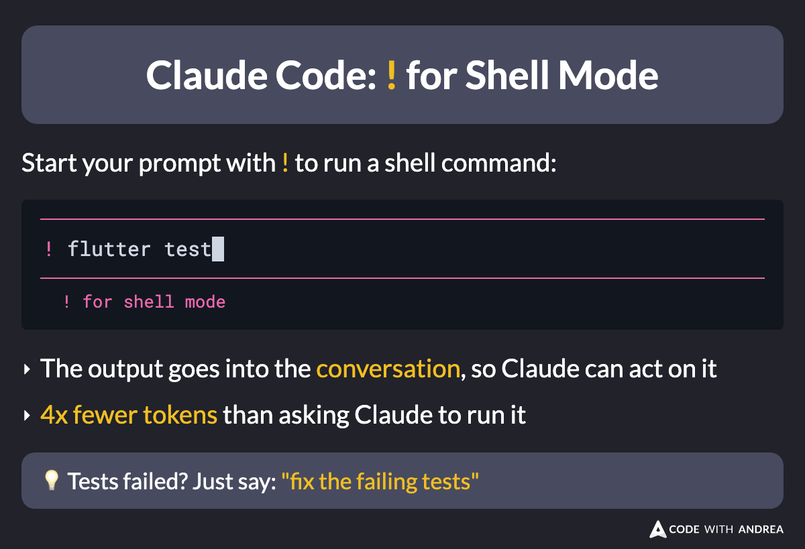

# Claude Code: ! for Shell Mode

Did you know?

You don't need to ask Claude Code to run commands for you.

Type them yourself with ! and Claude still sees the output, for a fraction of the tokens.

Handy for tests, builds, git status... anything you'd run in a second terminal.

<!--
Claude Code: ! for Shell Mode

Start your prompt with ! to run a shell command:

! flutter test

- The output goes into the conversation, so Claude can act on it
- 4x fewer tokens than asking Claude to run it

Tests failed? Just say: "fix the failing tests"
-->

---

| Previous | Next |
| -------- | ---- |
| [Relative & Absolute Imports in Dart](../0256-relative-absolute-imports-dart/index.md) | [Migrate to material_ui in One Command](../0258-migrate-material-ui-dart-fix/index.md) |

<!-- TWITTER|https://x.com/biz84/status/2121598825928552948 -->
<!-- LINKEDIN|https://www.linkedin.com/feed/update/urn:li:activity:7527364476648726528/ -->
