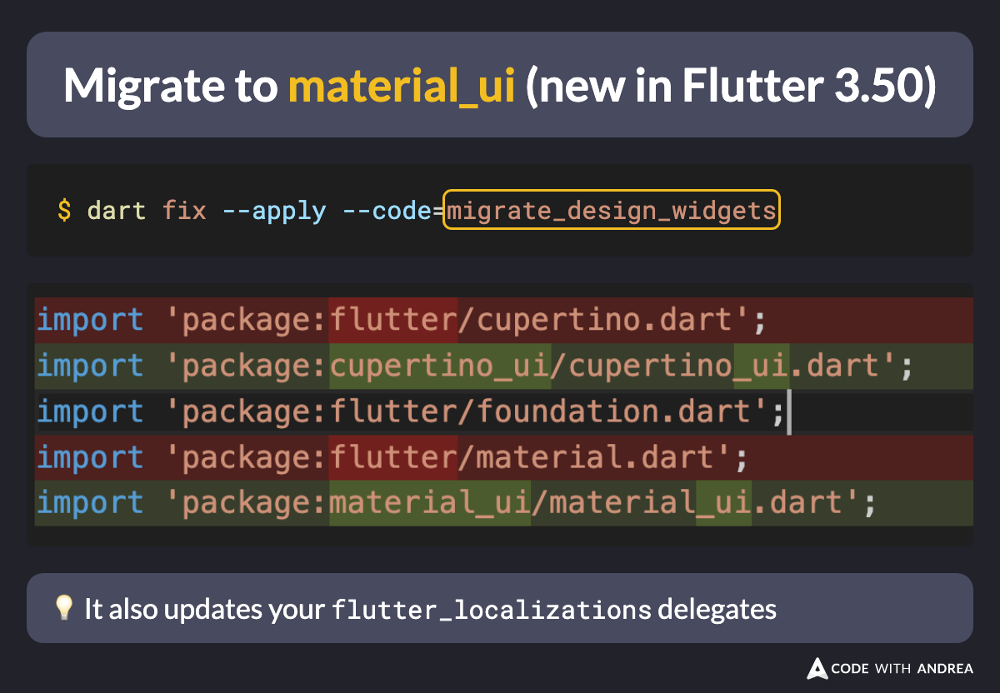

# Migrate to material_ui (new in Flutter 3.50)

Did you know?

Flutter 3.50 deprecates the built-in material.dart and cupertino.dart libraries in favor of the standalone material_ui and cupertino_ui packages.

No need to update every import by hand. A single dart fix command migrates your whole project.

<!--
Migrate to material_ui (new in Flutter 3.50)

$ dart fix --apply --code=migrate_design_widgets

- import 'package:flutter/cupertino.dart';
+ import 'package:cupertino_ui/cupertino_ui.dart';
  import 'package:flutter/foundation.dart';
- import 'package:flutter/material.dart';
+ import 'package:material_ui/material_ui.dart';

💡 It also updates your flutter_localizations delegates
-->

---

| Previous | Next |
| -------- | ---- |
| [Claude Code: ! for Shell Mode](../0257-claude-code-shell-mode/index.md) | [Count Claude Tokens with ant CLI](../0259-count-claude-tokens-ant-cli/index.md) |

<!-- TWITTER|https://x.com/biz84/status/2122256889371390260 -->
<!-- LINKEDIN|https://www.linkedin.com/feed/update/urn:li:activity:7528022654042136576/ -->
