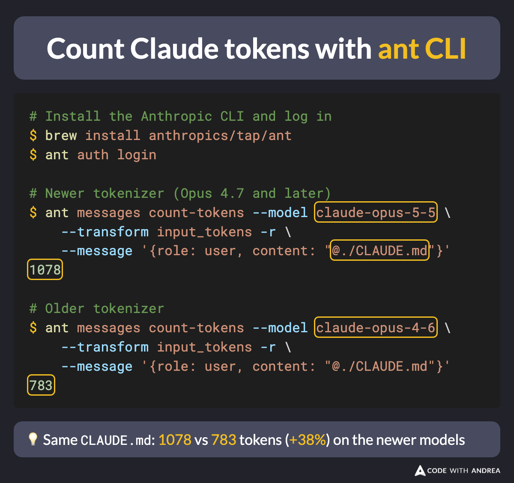

# Count Claude Tokens with ant CLI

Did you know?

Your CLAUDE.md is loaded into every Claude Code session, so every token counts.

And since Opus 4.7, the same file takes more tokens: 38% more for my CLAUDE.md.

The ant CLI shows you the real count for any model, so you can keep it lean.

<!--
Count Claude tokens with ant CLI

# Install the Anthropic CLI and log in
$ brew install anthropics/tap/ant
$ ant auth login

# Newer tokenizer (Opus 4.7 and later)
$ ant messages count-tokens --model claude-opus-5-5 \
    --transform input_tokens -r \
    --message '{role: user, content: "@./CLAUDE.md"}'
1078

# Older tokenizer
$ ant messages count-tokens --model claude-opus-4-6 \
    --transform input_tokens -r \
    --message '{role: user, content: "@./CLAUDE.md"}'
783

💡 Same CLAUDE.md: 1078 vs 783 tokens (+38%) on the newer models
-->

---

Two notes: each count includes a few tokens of message overhead, so treat it as close, not exact. And Opus 5.5 is cheaper per token than Opus 4.6, but with more tokens per file the cost comes out about the same. Measure your own files.

| Previous | Next |
| -------- | ---- |
| [Migrate to material_ui (new in Flutter 3.50)](../0258-migrate-material-ui-dart-fix/index.md) | |
